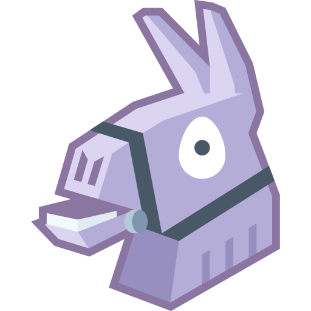

# Llama API

HTTP API to log in to Epic Games accounts (device code flow) and read the Fortnite data: account, V-Bucks, stats and the full locker. Built as the backend for Discord bots that show players' skins.

**Documentation:** [llamaapi.mintlify.site](https://llamaapi.mintlify.site)

## Endpoints

| Method | Route | Description |
|---|---|---|
| `POST` | `/auth/device` | Starts a login and returns the Epic authorization link |
| `GET` | `/auth/{session_id}` | Login status (`pending`, `completed`, `expired`, `error`) |
| `DELETE` | `/auth/{session_id}` | Ends the session and revokes the Epic token |
| `GET` | `/accounts/{session_id}/summary` | Account data, V-Bucks, platforms and stats |
| `GET` | `/accounts/{session_id}/locker` | Every cosmetic, by category and sorted by rarity, with names in English and Portuguese |
| `GET` | `/accounts/{session_id}/equipped` | Items equipped in the active loadout (skin, pickaxe, emotes…) |
| `POST` | `/render/{category}` | Locker PNG per category (`skins`, `backpacks`, `pickaxes`, `gliders`, `emotes`, `mythics`), names in English or Portuguese |
| `GET` | `/backgrounds/{name}.png` | Rarity backgrounds linked in each item's `images.background` (no API key) |
| `GET` | `/health` | Healthcheck (no API key) |

Every endpoint except `/health` and `/backgrounds` requires the `X-API-Key` header.

## Self-hosted or hosted

The API is made to be self-hosted: run your own instance with your own `API_KEY`. To use the hosted instance at `https://llamaapi.audibert.dev`, ask for an API key by [opening an issue](https://github.com/matheusaudibert/llama-api/issues/new).

## Running

Copy `.env.example` to `.env` and fill in `API_KEY` and the three Epic OAuth clients (`EPIC_SWITCH_CLIENT`, `EPIC_IOS_CLIENT`, `EPIC_EOS_CLIENT`, as base64 `client_id:client_secret`, from the [Epic auth clients list](https://github.com/MixV2/EpicResearch/blob/main/docs/auth/auth_clients.md)). No credential is hardcoded.

```bash
pip install -r requirements.txt
uvicorn api.main:app --port 8000 --env-file .env
```

Or with Docker:

```bash
docker build -t llama-api .
docker run -p 8000:8000 --env-file .env llama-api
```

Swagger UI at `http://localhost:8000/docs`.

## Documentation

The full documentation (guides, Docker deploy, discord.js example and API reference) is published at [llamaapi.mintlify.site](https://llamaapi.mintlify.site). Its source lives in [`docs/`](docs) and is built with [Mintlify](https://mintlify.com).

To run the documentation locally:

```bash
npm i -g mint
cd docs
mint dev
```

After changing endpoints or models, regenerate the specs:

```bash
python scripts/export_openapi.py
```
