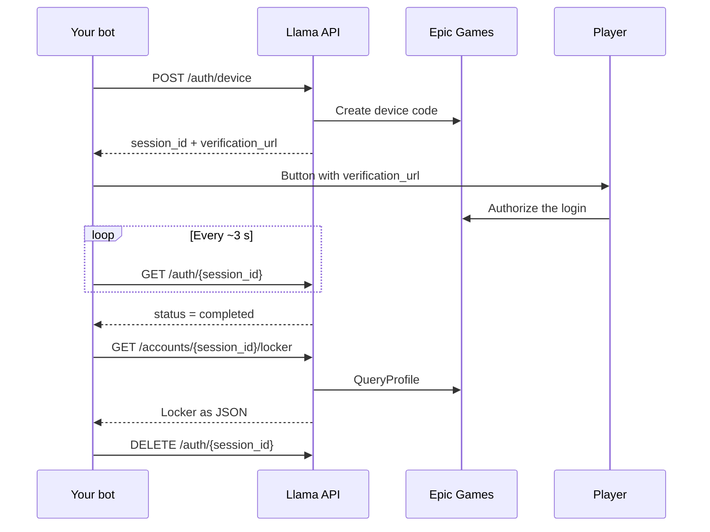

Llama API handles the hard part of a skin checker: logging in to the Epic Games account and collecting the data. Your bot only calls HTTP endpoints and decides how to show the result (embeds, locker image, etc.).

## What it does

- **Passwordless login**: uses the Epic device code flow. The player opens an official Epic link and authorizes; the API never sees the password.
- **Account summary**: email, country, 2FA, V-Bucks, connected platforms, level, wins and past seasons.
- **Full locker**: skins, backpacks, pickaxes, emotes, gliders, wraps, sprays and banners, with name, rarity, images and unlocked styles.
- **Locker images**: one ready-made PNG per category, plus one with only the mythic items.
- **Always up-to-date catalog**: loads the [fortnite-api.com](https://fortnite-api.com) catalog on startup, reloads it every 6 h and fetches items released after that on demand.

## How it works

The Epic tokens stay inside the API. Your bot only knows the `session_id`.

## Self-hosted or hosted

Llama API is made to be **self-hosted**: you run your own instance and set your own API key. See [Production deploy](/self-hosting/production).

There is also a hosted instance at `https://llamaapi.audibert.dev`. To use it, ask for an API key by [opening an issue on GitHub](https://github.com/matheusaudibert/llama-api/issues/new).

<Columns cols={2}>
  <Card title="Quickstart" icon="rocket" href="/quickstart">
    Run the API and do your first login in a few minutes.
  </Card>
  <Card title="Production deploy" icon="server" href="/self-hosting/production">
    Put the API online on any server or platform that runs Docker.
  </Card>
  <Card title="discord.js example" icon="discord" href="/guides/discord-bot">
    A complete `/checker` command in TypeScript.
  </Card>
  <Card title="API reference" icon="code" href="/api-reference/introduction">
    Every endpoint, parameter and response.
  </Card>
</Columns>

<Warning>
  The API uses client IDs from official Epic apps (Switch and iOS) in an unofficial way. Epic may block this at any time, and it is not allowed by the Epic terms of service. Use it at your own risk.
</Warning>
