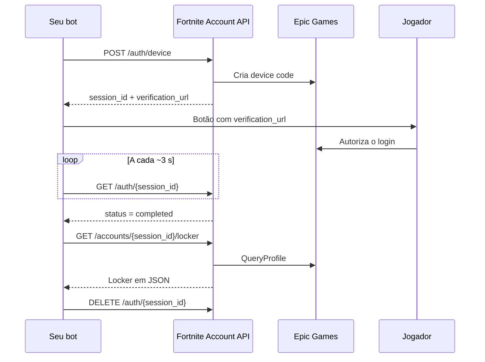

A Fortnite Account API cuida da parte difícil de um skin checker: o login na conta Epic Games e a coleta dos dados. O seu bot só chama endpoints HTTP e decide como mostrar o resultado (embeds, imagem do locker, etc.).

## O que ela faz

- **Login sem senha**: usa o device code flow da Epic. O jogador abre um link oficial da Epic e autoriza; a API nunca vê a senha.
- **Resumo da conta**: email, país, 2FA, V-Bucks, plataformas conectadas, nível, vitórias e temporadas passadas.
- **Locker completo**: skins, mochilas, picaretas, emotes, asas, envelopamentos, sprays e banners, com nome, raridade, imagens e estilos desbloqueados.
- **Catálogo sempre atualizado**: carrega o catálogo do [fortnite-api.com](https://fortnite-api.com) ao iniciar, recarrega a cada 6 h e busca na hora itens lançados depois disso.

## Como funciona

Os tokens da Epic ficam só na API. O seu bot conhece apenas o `session_id`.

<Columns cols={2}>
  <Card title="Início rápido" icon="rocket" href="/quickstart">
    Rode a API e faça o primeiro login em poucos minutos.
  </Card>
  <Card title="Deploy no Coolify" icon="server" href="/deploy/coolify">
    Coloque a API no ar na sua VPS da Hostinger.
  </Card>
  <Card title="Exemplo com discord.js" icon="discord" href="/guides/discord-bot">
    Comando `/checker` completo em TypeScript.
  </Card>
  <Card title="Referência da API" icon="code" href="/api-reference/introduction">
    Todos os endpoints, parâmetros e respostas.
  </Card>
</Columns>

<Warning>
  A API usa client IDs de apps oficiais da Epic (Switch e iOS) de forma não oficial. A Epic pode bloquear esse uso a qualquer momento, e ele não é permitido pelos termos de serviço da Epic. Use por sua conta e risco.
</Warning>
