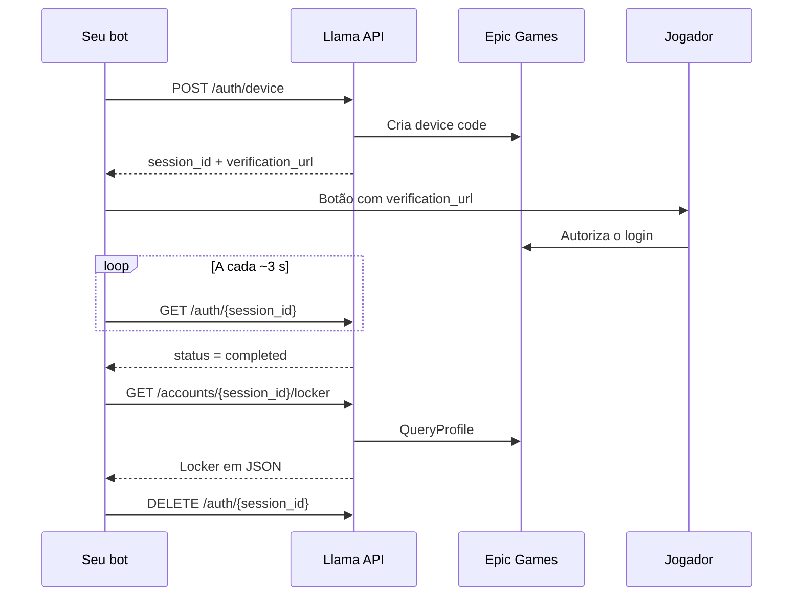

A Llama API cuida da parte difícil de um skin checker: o login na conta Epic Games e a coleta dos dados. O seu bot só chama endpoints HTTP e decide como mostrar o resultado (embeds, imagem do locker, etc.).

<Card title="Demo ao vivo" icon="play" href="https://llamachecker.audibert.dev/">
  Veja todas as funcionalidades no Llama Checker, um checker de dados da conta e de armário totalmente funcional feito com esta API: entre com a Epic Games e navegue pelo armário, pelos itens equipados e pelos dados da conta.
</Card>

## O que ela faz

- **Login sem senha**: usa o device code flow da Epic. O jogador abre um link oficial da Epic e autoriza; a API nunca vê a senha.
- **Resumo da conta**: email, país, 2FA, V-Bucks, plataformas conectadas, nível, vitórias e temporadas passadas.
- **Locker completo**: skins, mochilas, picaretas, emotes, asas, envelopamentos, sprays e banners, com nome, raridade, imagens e estilos desbloqueados.
- **Imagens do locker**: um PNG pronto por categoria, mais um só com os itens míticos.
- **Catálogo sempre atualizado**: carrega o catálogo do [fortnite-api.com](https://fortnite-api.com) ao iniciar, recarrega a cada 6 h e busca na hora itens lançados depois disso.

## Como funciona

Os tokens da Epic ficam só na API. O seu bot conhece apenas o `session_id`.

## Self-hosted ou hospedada

A Llama API foi feita para ser **self-hosted**: você roda a sua própria instância e define a sua própria API key. Veja [Deploy em produção](/pt-BR/self-hosting/production).

Também existe uma instância hospedada em `https://llamaapi.audibert.dev`. Para usá-la, peça uma API key [abrindo uma issue no GitHub](https://github.com/matheusaudibert/llama-api/issues/new).

<Columns cols={2}>
  <Card title="Início rápido" icon="rocket" href="/pt-BR/quickstart">
    Rode a API e faça o primeiro login em poucos minutos.
  </Card>
  <Card title="Deploy em produção" icon="server" href="/pt-BR/self-hosting/production">
    Coloque a API no ar em qualquer servidor ou plataforma com Docker.
  </Card>
  <Card title="Exemplo com discord.js" icon="discord" href="/pt-BR/guides/discord-bot">
    Comando `/checker` completo em TypeScript.
  </Card>
  <Card title="Referência da API" icon="code" href="/pt-BR/api-reference/introduction">
    Todos os endpoints, parâmetros e respostas.
  </Card>
</Columns>

<Warning>
  A API usa client IDs de apps oficiais da Epic (Switch e iOS) de forma não oficial. A Epic pode bloquear esse uso a qualquer momento, e ele não é permitido pelos termos de serviço da Epic. Use por sua conta e risco.
</Warning>
